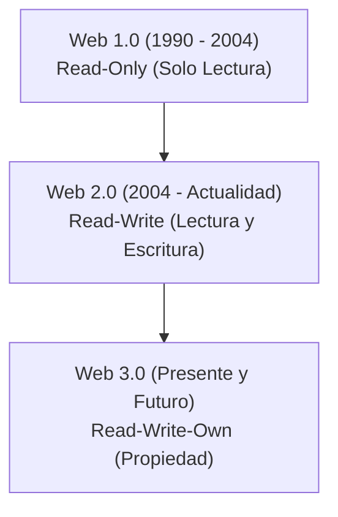
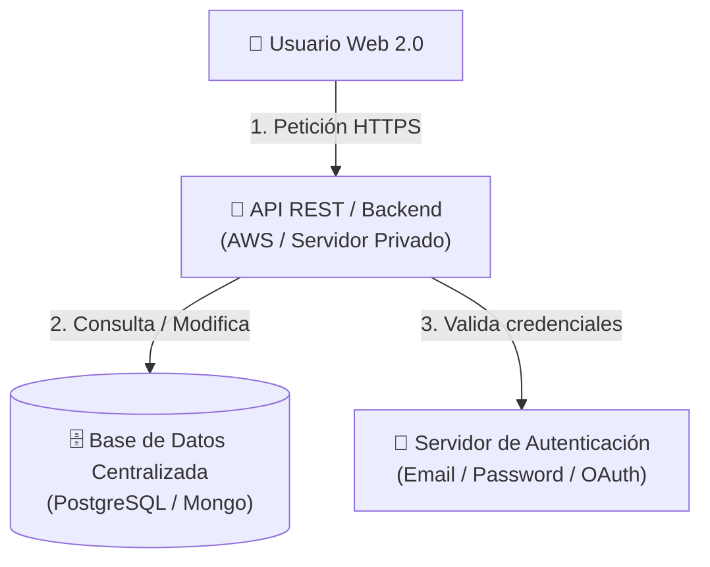
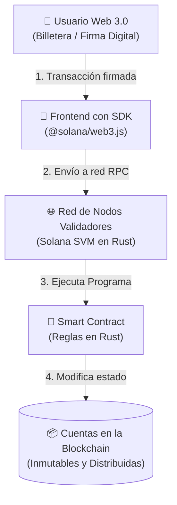

# 🌐 01. Evolución de la Web: Web 1.0, Web 2.0 y Web 3.0

Para entender el ecosistema de blockchain y Solana en este hackathon, es fundamental comprender qué problemas de la arquitectura web tradicional resuelve la Web 3.0.

---

## ⏳ La Evolución Histórica: De la Lectura a la Propiedad

---

## 1. Web 1.0 (La Web Estática — "Read-Only")

* **Período:** ~1990 a 2004.
* **Paradigma:** Los usuarios eran **consumidores pasivos** de información.
* **Arquitectura:**
  * Servidores web simples (Apache, Nginx) sirviendo páginas HTML estáticas y archivos CSS básicos.
  * No existían bases de datos relacionales dinámicas accesibles al usuario final ni JavaScript interactivo.
  * Los sitios web eran como folletos digitales o enciclopedias (ej. Yahoo! Directory, sitios personales de GeoCities, primeros diarios digitales).
* **Limitación:** El usuario no podía interactuar, comentar ni crear contenido; solo leer lo que el administrador del servidor publicaba.

---

## 2. Web 2.0 (La Web Social y de Plataformas — "Read-Write")

* **Período:** ~2004 hasta hoy.
* **Paradigma:** El usuario se convierte en **creador y consumidor** de contenido (redes sociales, blogs, apps web interactivas).
* **Arquitectura Tradicional Web 2.0:**
  * **Frontend:** Interfaces ricas y reactivas (React, Next.js, Vue, iOS, Android).
  * **Capa de Comunicación:** APIs RESTful, GraphQL o WebSockets mediante HTTP/HTTPS.
  * **Backend:** Servidores monolíticos o microservicios (Node.js, Spring Boot, FastAPI, Go) ejecutándose en la nube (AWS, Google Cloud, Azure).
  * **Base de Datos:** Almacenamiento centralizado (PostgreSQL, MySQL, MongoDB, Redis).
  * **Autenticación e Identidad:** Cuentas centralizadas (Email + Password con hash bcrypt, OAuth con Google/Facebook, Auth0, JWT).

### El Gran Problema de la Web 2.0:
1. **Centralización y Puntos Únicos de Falla:** Si AWS sufre una caída o la empresa cierra sus servidores, tu aplicación y tus datos desaparecen.
2. **Monopolio y Falta de Propiedad:** El usuario genera el contenido (videos en YouTube, publicaciones en Instagram, dinero en PayPal), pero la empresa es dueña de los datos, la base de datos y la cuenta. La plataforma puede suspender tu cuenta, censurarte o cambiar las reglas unilateralmente.
3. **Intermediación Financiera:** Enviar dinero por internet depende de pasarelas bancarias tradicionales (Stripe, PayPal, bancos) con altas comisiones, demoras de días hábiles y exclusión geográfica.

---

## 3. Web 3.0 (La Web Descentralizada — "Read-Write-Own")

* **Período:** En expansión activa.
* **Paradigma:** Los usuarios pueden **leer, escribir y poseer** sus activos, datos e identidad de forma soberana, sin intermediarios de confianza.
* **Diferencias Clave con la Arquitectura Tradicional:**

| Aspecto | Web 2.0 Tradicional | Web 3.0 (Solana / Blockchain) |
|---|---|---|
| **Identidad / Login** | Usuario / Contraseña guardados en una base de datos de la empresa, o "Sign in with Google". | **Billetera Criptográfica (Wallet):** Firma digital con clave pública y privada (ej. Phantom, Backpack). No hay contraseñas en servidores. |
| **Backend / Lógica** | Código privado alojado en un servidor central (AWS, Vercel, VPS). | **Smart Contracts (Programas On-Chain):** Código abierto, auditable y descentralizado ejecutado por miles de nodos validadores (en Rust en Solana). |
| **Base de Datos** | Base de datos privada (Postgres, MongoDB) modificable por quien tenga acceso `root`. | **Ledger de la Blockchain:** Libro mayor distribuido, inmutable y verificable públicamente por cualquiera. |
| **Monetización / Pagos** | Pasarelas bancarias externas (Mercado Pago, Stripe) con comisiones del 3-6% y demoras. | **Moneda Nativa y Tokens (SOL, USDC):** Pagos programables entre billeteras confirmados en 400 ms con comisiones de menos de $0.001. |
| **Gobernanza** | La empresa decide los cambios de términos y condiciones. | **Gobernanza On-Chain / DAOs:** La comunidad o poseedores de tokens votan sobre las reglas y el tesoro del proyecto. |

---

## 🎯 Conclusión para el Hackathon
En este hackathon, tu proyecto no necesita eliminar la Web 2.0: **las mejores dApps combinan lo mejor de ambos mundos**:
* Usas tecnologías Web 2.0 modernas para un **Frontend veloz y accesible** (React, Next.js, Tailwind).
* Usas **Web 3.0 y Solana** para lo que verdaderamente requiere confianza: **identidad sin fricción, pagos instantáneos, registros transparentes y propiedad real de activos**.
