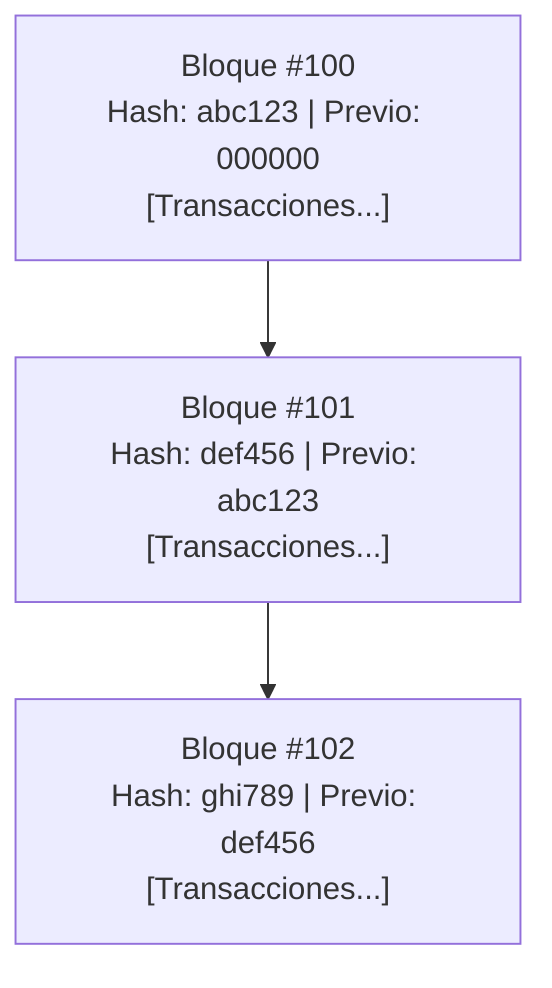
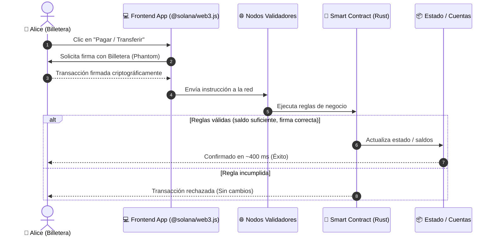

# ⛓️ 02. ¿Qué es una Blockchain? Arquitectura y Principios de Sistemas Distribuidos

---

## 📌 Definición Esencial
Una **Blockchain** (cadena de bloques) es una **base de datos distribuida, pública y compartida** que mantiene un registro continuo de transacciones ordenadas cronológicamente, protegidas mediante criptografía y validadas por una red de computadoras independientes (llamadas **nodos** o **validadores**) sin necesidad de una autoridad central.

---

## ⚖️ Comparación Directa: Base de Datos Web 2.0 vs Blockchain Web 3.0

Para un desarrollador acostumbrado al desarrollo tradicional, la mejor forma de entender la blockchain es compararla con una base de datos relacional tradicional:

| Característica | Base de Datos Tradicional (PostgreSQL / MySQL) | Blockchain (Solana / Bitcoin / Ethereum) |
|---|---|---|
| **Almacenamiento** | Servidor central o cluster en la nube (AWS RDS, GCP Cloud SQL). | Red descentralizada de miles de computadoras alrededor del mundo. |
| **Operaciones CRUD** | **C**reate, **R**ead, **U**pdate, **D**elete. | **Append-Only:** Solo se puede leer (**Read**) y agregar datos nuevos (**Append**). Nada se borra ni se edita hacia atrás. |
| **Control y Permisos** | Un Administrador (`root` / DBA) puede alterar, censurar o borrar registros con `DROP TABLE` o `UPDATE`. | **Ningún nodo individual tiene privilegios:** Las reglas se aplican mediante consenso criptográfico y código inmutable. |
| **Confianza** | Confianza ciega en la empresa que administra el servidor. | **Trustless (Sin necesidad de confianza):** La certeza matemática y criptográfica reemplaza la necesidad de confiar en personas. |
| **Punto Único de Falla** | Si el datacenter central colapsa, el servicio queda inactivo. | **Tolerancia a fallas extrema:** Si el 30% de los nodos cae, la red sigue operando con total normalidad. |

---

## 🧱 Los 4 Pilares Técnicos de una Blockchain

### 1. Bloques y Enlace Criptográfico (Hash Chaining)
Cada bloque de información contiene:
* Una lista de **transacciones validadas**.
* Una **marca de tiempo (timestamp)**.
* Su propio identificador criptográfico único (**Hash del bloque actual**).
* El **Hash del bloque inmediatamente anterior**.

> **¿Por qué es inmutable?**  
> Si un atacante intentara modificar maliciosamente una transacción del Bloque #100, el hash de ese bloque cambiaría instantáneamente a `xyz999`. Esto rompería el enlace del Bloque #101 (que esperaba `abc123`), invalidando todos los bloques subsiguientes de la cadena. El resto de la red detecta la incongruencia y descarta el bloque adulterado de inmediato.

---

### 2. Criptografía Asimétrica (Llave Pública y Llave Privada)
En la Web 2.0, tu identidad es un usuario y contraseña guardado en una base de datos.  
En la Blockchain, tu identidad es un par de claves matemáticas:

* **Llave Pública (Public Key / Wallet Address):** Equivale a tu número de cuenta bancaria o CBU/CVU. Es pública y cualquiera puede verla para enviarte fondos o consultar tu saldo.
* **Llave Privada (Private Key / Frase Semilla):** Equivale a tu firma personal y PIN secreto. Nunca sale de tu dispositivo. Con ella se firman criptográficamente las transacciones para autorizar transferencias o interacciones.

---

### 3. Mecanismos de Consenso (Cómo se ponen de acuerdo los nodos)
¿Cómo deciden miles de computadoras qué transacciones son válidas sin un jefe central?

1. **Proof of Work (PoW - Prueba de Trabajo):**  
   * Usado en Bitcoin.
   * Los mineros compiten resolviendo acertijos matemáticos con fuerza bruta computacional. Es sumamente seguro, pero lento (~7 transacciones por segundo) y consume mucha energía.
2. **Proof of Stake (PoS - Prueba de Participación):**  
   * Usado en Ethereum moderno y base de Solana.
   * Los validadores bloquean fondos de la criptomoneda nativa (Stake) como garantía. Si intentan validar transacciones falsas, la red les confisca sus fondos (*slashing*). Es mucho más ecológico y rápido.
3. **Proof of History (PoH - Innovación de Solana):**  
   * Explicado en detalle en el siguiente documento. Resuelve el problema del reloj global en sistemas distribuidos.

---

### 4. Smart Contracts (Programas Descentralizados)
Son programas informáticos almacenados directamente en la blockchain que se ejecutan automáticamente cuando se cumplen ciertas condiciones preprogramadas.

* **En Web 2.0:** Son como los *Endpoints* de una API REST o *Stored Procedures* de una base de datos, pero ejecutados de forma privada en un backend.
* **En Web 3.0:** Se ejecutan en miles de nodos simultáneamente. Nadie (ni siquiera su creador) puede cambiar el código una vez desplegado si no se previó un mecanismo explícito de actualización.

