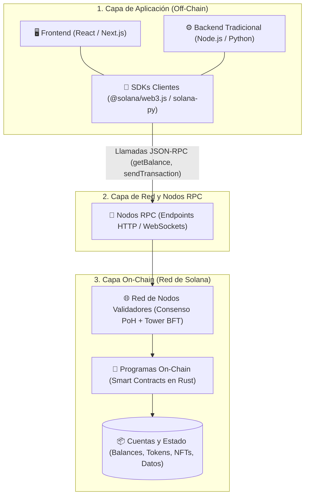

# ⚡ 03. ¿Qué es Solana? Arquitectura, Nodos y Funcionamiento

---

## 📌 ¿Es Solana una librería de backend?
**No.** Esta es una de las dudas más frecuentes cuando un desarrollador de Web 2.0 se acerca al ecosistema:

> **Solana no es una librería ni un framework de backend (como Express, NestJS o Spring Boot).**  
> **Solana es una red blockchain pública completa de Capa 1 (Layer 1)**: una infraestructura global descentralizada compuesta por miles de servidores (llamados **validadores**) que procesan transacciones, almacenan el estado del mundo y ejecutan programas de forma sincronizada.

Para interactuar con esta red desde tu frontend o tu backend tradicional, **sí utilizas librerías cliente (SDKs)** como `@solana/web3.js` o `@solana/kit` en JavaScript/TypeScript, o `solana-py` en Python.

---

## 🏗️ La Arquitectura de Solana Dividida en 3 Capas

---

## 🔄 Comparativa de Arquitectura: Web 2.0 vs Solana Web 3.0

Para que quede clarísimo cómo mapear tus conocimientos previos:

| Componente | En una Web App Tradicional (Web 2.0) | En una DApp de Solana (Web 3.0) |
|---|---|---|
| **Frontend** | React / Next.js / Flutter / Tailwind. | Exactamente lo mismo: React, Next.js, Vue, mobile. |
| **Login / Auth** | Formulario de email y password, sesión en cookies o JWT. | **Billetera Cripto (Phantom, Solflare, Backpack)** mediante `@solana/wallet-adapter`. |
| **Endpoints / Lógica de Servidor** | Controladores en Spring Boot, Express o FastAPI (`POST /transferir`). | **Instrucciones enviadas a un Programa On-Chain (escrito en Rust con Anchor)**. |
| **Base de Datos** | Tablas en PostgreSQL, colecciones en MongoDB. | **Cuentas de Solana (Accounts)**: bloques de memoria asignados a llaves públicas. |
| **Servidores / Hosting de API** | AWS EC2, Vercel, Railway, Kubernetes. | **Red de Validadores de Solana**: nadie puede apagar el servidor. |
| **Conectores / Clientes** | `fetch()`, `axios`, Prisma ORM, JPA/Hibernate. | `@solana/web3.js`, Anchor Client SDK. |

---

## 🚀 Las 5 Innovaciones Técnicas que hacen a Solana Ultrarrápida

Solana procesa **miles de transacciones por segundo (TPS)** con tiempos de bloque de **~400 milisegundos** y comisiones inferiores a **$0.001**. Esto se debe a 5 innovaciones clave:

### 1. Proof of History (PoH - Prueba de Historia)
* **El problema en sistemas distribuidos:** En blockchains tradicionales (como Bitcoin o Ethereum), los nodos pierden mucho tiempo comunicándose entre sí para ponerse de acuerdo en **qué hora es** y **en qué orden exacto** entraron las transacciones antes de empaquetar un bloque.
* **La solución de Solana:** PoH es una función criptográfica de retardo verificable (VDF, basada en SHA-256 en bucle secuencial continuo). Crea un **reloj criptográfico global** previo al consenso. Cada nodo puede verificar el paso del tiempo y el orden de los eventos sin tener que esperar la respuesta de los demás nodos.

### 2. Tower BFT
Una versión personalizada y optimizada del algoritmo de consenso PBFT (*Practical Byzantine Fault Tolerance*) que aprovecha Proof of History para alcanzar la confirmación final de bloques a la velocidad de la luz.

### 3. Sealevel (Motor de Ejecución Paralelo)
* En la mayoría de blockchains (como Ethereum Virtual Machine / EVM), los contratos inteligentes se ejecutan **uno por uno de forma secuencial (un solo hilo)**. Si alguien satura la red enviando transacciones a un contrato popular, toda la red se vuelve lenta y cara.
* **En Solana:** Sealevel permite ejecutar **miles de transacciones en paralelo en múltiples núcleos de CPU y GPU**. Como cada instrucción en Solana declara de antemano qué cuentas va a leer y escribir, si dos transacciones no tocan las mismas cuentas, se procesan simultáneamente sin conflicto.

### 4. Turbine (Propagación de Bloques tipo BitTorrent)
Para transmitir datos gigantescos a miles de validadores sin saturar el ancho de banda del validador líder, Solana divide los bloques en pequeños paquetes (*shreds*) y los distribuye en una estructura de árbol, similar a cómo funciona BitTorrent.

### 5. Gulf Stream (Reenvío sin Mempool)
En Ethereum existe una sala de espera llamada *mempool* donde las transacciones aguardan a que un minero las seleccione. En Solana, los nodos conocen de antemano qué validadores serán los líderes de los próximos bloques gracias a PoH, por lo que las transacciones se envían directamente al validador líder que las va a procesar, reduciendo drásticamente la latencia.

---

## 📦 El Modelo de Cuentas (Accounts Model): La Clave de Solana

A diferencia de Ethereum (donde un contrato inteligente guarda su código y sus variables juntos en el mismo lugar), **en Solana el código y los datos están estrictamente separados**:

1. **Los Programas son Apátridas (Stateless):**  
   El código en Rust que subes a Solana solo contiene la lógica ejecutable. No guarda variables internas que cambien de valor.
2. **Todo se guarda en Cuentas (Accounts):**  
   Una cuenta en Solana es como un archivo en un sistema de archivos o un registro en una base de datos. Tiene:
   * Su dirección (`Pubkey`).
   * Cantidad de saldo en **Lamports** ($1 \text{ SOL} = 10^9 \text{ Lamports}$).
   * Un arreglo de bytes de datos (`data`) para guardar información arbitraria (balances de tokens, inventario de un juego, etc.).
   * El `owner` (dueño): la dirección del programa que tiene permisos exclusivos para modificar esos datos.
3. **Exención de Renta (Rent-Exempt):**  
   Almacenar datos en los validadores de Solana consume memoria RAM. Para mantener una cuenta viva en la red, se debe depositar una pequeña cantidad de SOL (renta). Si mantienes suficiente saldo en la cuenta para ser *rent-exempt*, tus datos permanecerán en la red de forma indefinida y gratuita; y si cierras la cuenta, **ese saldo en SOL se te devuelve por completo**.
