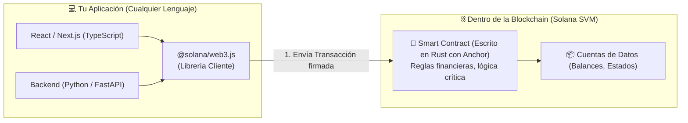

# 🦀 04. ¿Por qué Rust en Solana? El Motor de los Smart Contracts

---

## 📌 ¿En qué parte del proyecto entra Rust?

Una de las confusiones más comunes es creer que para hacer un proyecto en Solana hay que escribir **toda** la aplicación en Rust. **Esto no es así**:

* **Capa 1: Tu Aplicación de Usuario (Frontend / Backend)**  
  Aquí usas los lenguajes que ya conoces: **TypeScript, JavaScript, Python, C#, Kotlin**.  
  Si tu app solo necesita recibir pagos en SOL, enviar tokens, conectar billeteras (como Phantom) o consultar saldos, **no necesitas escribir una sola línea de Rust**. Todo se hace consumiendo librerías cliente como `@solana/web3.js` o Solana Pay.
* **Capa 2: El Interior de la Blockchain (Programas On-Chain)**  
  Aquí es donde **sí entra Rust**. Solo necesitas programar en Rust cuando necesitas **crear tus propias reglas descentralizadas** que deban vivir y ejecutarse dentro de la red (por ejemplo: un protocolo de préstamos, un sistema de votación infalsificable, o un contrato de custodia de fondos / *escrow*).



---

## 🚀 ¿Por qué los Fundadores de Solana Eligieron Rust?

Solana fue diseñada para competir en velocidad y costos con los gigantes del procesamiento financiero global (como VISA o Nasdaq). Para procesar más de 50.000 transacciones por segundo con bloques de **400 ms**, los fundadores descartaron otros lenguajes populares por tres razones técnicas decisivas:

### 1. Ausencia Total de Garbage Collector (Recolector de Basura)
* **¿Qué pasa en lenguajes como Java, Go, C# o JavaScript?**  
  Tienen un recolector de basura (*Garbage Collector*) que se activa periódicamente en segundo plano para limpiar la memoria no utilizada. Cuando el recolector se activa, **pausa la ejecución del programa durante unos milisegundos**.
* **El impacto en Solana:**  
  En una red con bloques de apenas 400 milisegundos, una pausa de recolección de basura rompería la sincronización de miles de validadores globales y causaría caídas de red o demoras inaceptables.
* **La ventaja de Rust:**  
  Rust no tiene recolector de basura. Gestiona la memoria en **tiempo de compilación** mediante su sistema de **Ownership (Propiedad)**. Cuando una variable sale de su bloque (`{}`), la memoria se libera de forma instantánea y determinista a costo cero en ejecución.

---

### 2. Seguridad de Memoria en Compilación (Memory Safety)
En el mundo de los Smart Contracts, un fallo en el código significa pérdida irreversible de millones de dólares.

En Ethereum (con Solidity) o en C/C++, errores históricos como:
* Reentrancy attacks (ataques de reentrada).
* Desbordamiento de enteros (*Integer Overflow*).
* Punteros nulos o colgantes (*Dangling Pointers / Null Pointer Exceptions*).

**En Rust, estos errores simplemente no compilan**:
* **Ownership y Borrowing:** Garantizan que no existan accesos concurrentes no autorizados a la memoria ni condiciones de carrera (*data races*).
* **Tipado estricto (`u64`, `Option`, `Result`):** No existe `null`. Las operaciones que pueden fallar devuelven obligatoriamente un `Result<T, E>` que el desarrollador está obligado a manejar antes de que el código compile.

---

### 3. Compilación a SBF / eBPF (Solana Bytecode Format)
Rust utiliza **LLVM** como infraestructura de compilación. Esto permite que el código en Rust se compile directamente a **Solana Bytecode Format (SBF)**, una variante optimizada del formato de instrucciones de bajo nivel **eBPF** del kernel de Linux.
* Los validadores ejecutan las instrucciones de SBF **casi a la velocidad del procesador físico (bare metal)**.
* Proporciona un entorno aislado (*sandbox*) donde un programa malicioso jamás puede dañar la memoria del sistema operativo del validador.

---

## ⚓ El Framework Anchor: El "Spring Boot" o "Next.js" de Solana

Escribir programas en Solana usando Rust nativo "puro" puede ser verboso, ya que requiere deserializar manualmente los arreglos de bytes de cada cuenta y escribir docenas de validaciones de seguridad repetitivas.

Para resolver esto, la comunidad creó **[Anchor](https://www.anchor-lang.com/)**:
* **Macros declarativas:** Permiten definir qué cuentas requiere una instrucción y qué permisos deben tener con simples anotaciones (como `@NotNull` o `@Entity` en Spring/Java).
* **Seguridad automática:** Anchor valida automáticamente si la persona que llama es el dueño de la cuenta, si tiene fondos suficientes y si las llaves coinciden.
* **Generación automática de IDL:** Al compilar tu contrato en Rust, Anchor genera un archivo JSON llamado **IDL (Interface Description Language)**, similar a una especificación OpenAPI/Swagger. Con este JSON, tu frontend en TypeScript tiene tipos autocompletados para interactuar con el contrato sin escribir código a ciegas.

```rust
// Ejemplo representativo de un programa con Anchor en Rust:
use anchor_lang::prelude::*;

declare_id!("TuProgramaID111111111111111111111111111111");

#[program]
pub mod mi_primer_programa {
    use super::*;

    pub fn inicializar(ctx: Context<Inicializar>, valor_inicial: u64) -> Result<()> {
        let cuenta_datos = &mut ctx.accounts.cuenta_datos;
        cuenta_datos.saldo = valor_inicial;
        Ok(())
    }
}

#[derive(Accounts)]
pub struct Inicializar<'info> {
    #[account(init, payer = usuario, space = 8 + 8)]
    pub cuenta_datos: Account<'info, CuentaDatos>,
    #[account(mut)]
    pub usuario: Signer<'info>,
    pub system_program: Program<'info, System>,
}

#[account]
pub struct CuentaDatos {
    pub saldo: u64,
}
```

---

## 🔄 El Ciclo de Vida de una Regla en Solana (De Código a Validación)

1. **Escritura:** Escribes tu lógica en Rust (utilizando Anchor).
2. **Compilación:** `anchor build` compila tu código a un archivo binario `.so` (bytecode SBF).
3. **Despliegue (Deploy):** Envías el binario a Solana Devnet/Mainnet mediante una transacción. La red le asigna una dirección pública (`Program ID`).
4. **Llamada desde tu App:** Tu frontend en TypeScript importa el IDL, arma la transacción y solicita la firma de la billetera del usuario.
5. **Validación Global:** Miles de nodos validadores reciben la instrucción, ejecutan el bytecode en su máquina virtual SVM, comprueban que las condiciones se cumplan y actualizan el saldo de las cuentas en el ledger. Si una sola comprobación falla, la transacción se aborta sin costo de estado.
