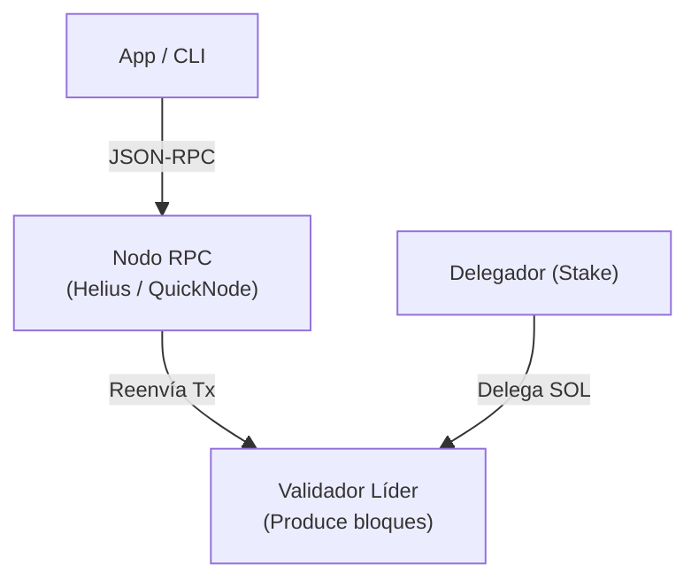

# 🌐 Sesión 3: Fundamentos de Blockchain, Infraestructura de Solana y CLI

Basado en la sesión 3 del **Rust Bootcamp (Dev3pack x Solana)** (por Santiago).  
🎥 Video original: [Session 3 - Blockchain y Solana CLI](https://www.youtube.com/watch?v=gZLBW0FJbHk)  
Transcripción completa guardada en: [`../transcripciones/transcripcion_rust_session_3.txt`](../transcripciones/transcripcion_rust_session_3.txt)

---

## 📌 1. Conceptos Clave de Blockchain y Hashes `[0:08:25]` `[0:13:51]`

Una blockchain es un **libro contable (*ledger*) compartido, replicado y *append-only*** (solo se agrega, nunca se borra hacia atrás) que resuelve el problema de la confianza y el doble gasto sin depender de un servidor central.

* **Funciones Hash (256 bits):** Son deterministas, de longitud fija, unidireccionales y tienen **efecto avalancha** (cambiar una sola letra cambia por completo el hash).
* **Encadenamiento:** Cada bloque incluye el hash del bloque anterior; alterar un dato pasado invalida toda la cadena posterior y los nodos lo rechazan.

---

## 🔑 2. Wallets, Claves y Criptografía `[0:17:01]`

* En Solana se utilizan pares de llaves **Ed25519**.
* La dirección pública se codifica en **Base58** (sin caracteres ambiguos como `0`, `O`, `I`, `l`).
* No existe recuperación de contraseña centralizada: quien posee la clave privada (*seed phrase*) controla los fondos.

---

## 🖥️ 3. Nodos, Validadores, RPC y Delegadores `[0:18:41]`

* **Validador:** Verifica transacciones, vota en el consenso y produce bloques (~400 ms por bloque en Solana).
* **Nodo RPC:** Expone una API JSON-RPC para que las apps consulten datos o envíen transacciones. Proveedores recomendados: **Helius, Triton, QuickNode, Alchemy** (los RPCs públicos tienen límites estrictos).
* **Delegador:** Aporta SOL en *staking* a un validador para sumar peso de voto y recibir recompensas (~4–5%).

---

## ⚖️ 4. PoW vs. PoS y el Trilema de la Blockchain `[0:21:57]` `[0:24:42]`

* **Proof of Work (Bitcoin):** Seguridad basada en cómputo eléctrico (~10 min por bloque).
* **Proof of Stake (Solana / Ethereum):** Seguridad basada en capital bloqueado (*stake*), mucho más veloz y eficiente.
* **Diferenciadores de Solana `[0:30:47]`:** Bloques cada **400 ms**, comisión base de **5,000 lamports** (`0.000005 SOL`) y **estado global único** sin fragmentación en Layer 2.

---

## 🛠️ 5. Clusters y Práctica con Solana CLI `[0:35:29]` `[0:37:00]`

* **Clusters:** `Mainnet` (dinero real), `Devnet` (desarrollo con fondos gratis), `Testnet` (pruebas de validadores) y `Local` (red en tu propia máquina).
* **Comandos clave probados en vivo:**
  * `solana --version` (v4.3.2 en clase) y configuración hacia `devnet`.
  * Generación de *keypairs* y consulta de dirección pública.
  * `solana airdrop` / fondeo desde faucet web y verificación con `solana balance`.
  * `solana transfer` (envío de 1 SOL entre wallets locales e inspección en el explorador).
* **Consulta directa al RPC sin librerías `[0:56:17]`:** Llamada HTTP con `curl` al método `getBalance` de JSON-RPC.
* **Expiración del *blockhash* `[1:00:29]`:** Cada *blockhash* reciente expira tras **150 bloques** (~1 minuto).

---

## 📦 6. Los 5 Campos de una Cuenta y Anatomía de Transacción `[0:53:22]`

Toda cuenta en Solana posee 5 campos: `lamports` (saldo), `data` (bytes o código), `owner` (programa dueño), `executable` (booleano) y `rent_epoch` / exención de renta.  
Toda transacción incluye: **firmas**, *blockhash* reciente, comisión, cuentas involucradas, instrucciones, logs y consumo de cómputo.
