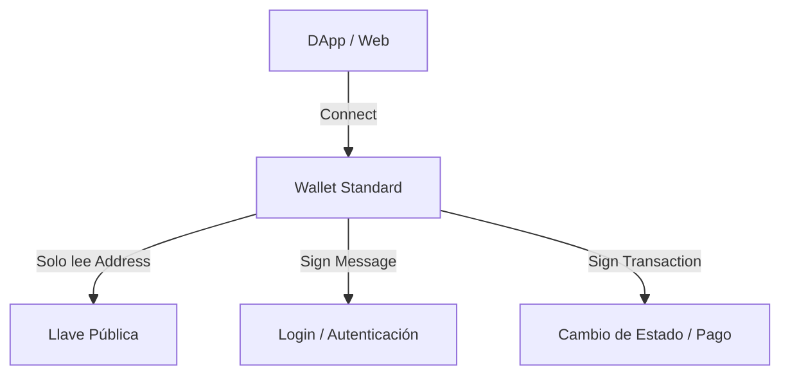

# 🔐 Sesión 4: Wallets, Custodia, Seguridad, Wallet Standard y Multisig

Basado en la sesión 4 del **Rust Bootcamp (Dev3pack x Solana)** (por Santiago).  
🎥 Video original: [Session 4 - Wallets y Seguridad en Solana](https://www.youtube.com/watch?v=ePiZBDkkUfA)  
Transcripción completa guardada en: [`../transcripciones/transcripcion_rust_session_4.txt`](../transcripciones/transcripcion_rust_session_4.txt)

---

## 📌 1. Wallets, Keypairs y Seed Phrases `[0:11:04]`

* **Las wallets guardan llaves, no monedas:** Tus fondos (SOL, USDC, NFTs) viven siempre *on-chain*. Podés importar tu *seed phrase* en otra app (ej. pasar de Phantom a Solflare) sin mover fondos.
* **Direcciones:** Claves públicas codificadas en **Base58** (32 a 44 caracteres).
* **Seed Phrase:** 12 o 24 palabras (se recomienda 24). Las transacciones son **irreversibles**.

---

## 🏦 2. Custodiales vs. No Custodiales y Tipos de Wallets `[0:16:47]` `[0:21:30]`

* **No Custodial (*"Not your keys, not your coins"*):** Phantom, Solflare, Backpack, Jupiter. Vos controlás las llaves privadas.
* **Custodial:** Exchanges (ej. Binance) donde un tercero custodia las llaves (riesgo de quiebras como FTX o bloqueo de retiros).
* **Calientes vs. Frías:**
  * *Calientes:* Conectadas a internet (extensiones, apps móviles, CLI). Ideales para operar el día a día.
  * *Frías:* Dispositivos físicos offline (ej. **Ledger**) para ahorros a largo plazo.
* **Embedded Wallets (para usuarios Web2):** Proveedores recomendados para onboarding con email/Google: **Privy** (adquirido por Stripe), **Coinbase Developer Platform (CDP)**, **Crossmint**, **Openfort**.

---

## 🔌 3. Firmar Transacciones vs. Mensajes y Wallet Standard `[0:29:18]`

* **Conectar (`connect`):** Solo comparte tu dirección pública para leer balances; no autoriza gastos.
* **Firmar mensaje (`signMessage`):** Prueba criptográficamente que sos dueño de esa dirección (usado para logins).
* **Firmar transacción:** Autoriza transferencias o cambios de estado *on-chain*.
* **Wallet Standard:** Estándar unificado que permite a cualquier DApp descubrir y conectarse a Phantom, Solflare, Backpack o Jupiter sin código específico por billetera.

---

## 🛡️ 4. Seguridad, Estafas Comunes y Buenos Hábitos `[0:33:39]`

* **Amenazas frecuentes:** Sitios de *phishing* (anuncios falsos en buscadores), *airdrops* falsos con enlaces maliciosos y *drainers* (una sola firma maliciosa vacía todos tus tokens).
* **Regla de 3 pasos antes de firmar `[0:38:47]`:**
  1. Verificar la URL exacta.
  2. Revisar la vista previa (simulación de montos y comisiones).
  3. Hacer caso a las alertas de la wallet y rechazar ante la menor duda.
* **Buenos hábitos:** Usar una **wallet *burner*** separada para desarrollar y testear; respaldar la *seed phrase* en papel o metal (jamás en capturas de pantalla, nube, mails ni chats).

---

## 🧪 5. Demo Práctica y Multisig (`Squads`) `[0:41:10]` `[0:51:52]`

* **Demo en vivo:** Instalación de **Jupiter Wallet**, inspección en **Solscan**, conexión a un sitio de prueba y firma de mensaje de autenticación (eliminando la wallet tras exponer la *seed* en cámara).
* **Multisignature (Multisig) `[0:51:52]`:** Cuentas controladas por múltiples firmantes con un umbral (*threshold*, ej. 2 de 3 firmas requeridas para mover fondos). En Solana la solución estándar es **Squads**.
