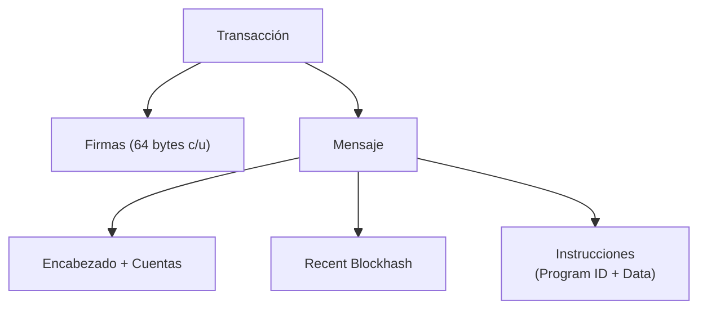

# 🧱 Sesión 5: Arquitectura de Solana — Cuentas, PDAs y Transacciones

Basado en la sesión 5 del **Rust Bootcamp (Dev3pack x Solana)** (por Fabián).  
🎥 Video original: [Session 5 - Cuentas, PDAs y Transacciones](https://www.youtube.com/watch?v=8nOlUikkBXE)  
Transcripción completa guardada en: [`../transcripciones/transcripcion_rust_session_5.txt`](../transcripciones/transcripcion_rust_session_5.txt)

---

## 📌 1. Stablecoins y Modelo de Cuentas (Los 5 Campos) `[0:08:40]` `[0:13:30]`

* **Stablecoins (USDC / USDT):** Activos paridad 1:1 con el USD sobre Solana, ideales para pagos evitando la volatilidad de SOL.
* **"En Solana todo es una cuenta":** La red funciona como un enorme almacén clave-valor. Toda cuenta tiene exactamente **5 campos**:
  1. **`Address`:** Clave pública de 32 bytes (Base58).
  2. **`Lamports`:** Saldo en la unidad mínima ($1 \text{ SOL} = 10^9 \text{ lamports}$).
  3. **`Data`:** Arreglo de bytes crudos (vacío en wallets; guarda estado o bytecode en programas/datos).
  4. **`Owner`:** Dirección del programa autorizado a modificar `data` o debitar lamports.
  5. **`Executable`:** Booleano (`true` si la cuenta almacena un programa).

---

## 🔐 2. Propiedad, System Program y Renta (`Rent`) `[0:21:50]`

* **Regla de propiedad:** Solo el programa **`Owner`** puede modificar `data` o restar lamports de una cuenta. Cualquier otro programa solo puede leerla o sumarle lamports.
* **`System Program` (`1111...1111`):** Es el *owner* de las wallets normales y el encargado de crear cuentas nuevas y transferir SOL nativo.
* **Separación Código / Estado:** Los programas son apátridas (*stateless*); los datos viven en cuentas separadas propiedad del programa.
* **Renta (*Rent-Exempt*):** Saldo mínimo bloqueado en lamports para existir en la memoria de los validadores (~**0.00089 SOL** o `890,880` lamports para 0 bytes, aumentando según tamaño). **Es reembolsable al cerrar la cuenta.**

---

## 🧬 3. PDAs (Program Derived Addresses) `[0:26:47]`

* Son direcciones generadas de forma determinista a partir de un `Program ID` y semillas (*seeds*).
* **No tienen clave privada** (caen fuera de la curva Ed25519).
* Solo el programa dueño puede "firmar" por ellas de forma programática mediante `invoke_signed`, permitiendo crear bóvedas, *escrows* y cuentas de estado por usuario sin llaves privadas humanas.

---

## 🔍 4. Anatomía de una Transacción e Instrucciones `[0:32:47]` `[0:40:57]`

* Cada instrucción especifica: qué `Program ID` invocar, qué cuentas leer/escribir (y cuáles deben firmar) y los bytes de argumentos (`data`).
* **Ejemplo inspeccionado en Solscan `[0:42:17]`:** Un *swap* en **Jupiter Aggregator V6** (6 wSOL $\rightarrow$ 500 USDC), revisando su árbol de instrucciones, `Compute Budget` e **IDL**.

---

## ⚡ 5. Atomicidad, Límites, Comisiones y Ciclo de Vida `[0:46:15]` `[0:51:41]`

* **Atomicidad:** Todo o nada. Si falla una sola instrucción dentro de la transacción, se revierten todos los cambios (aunque se cobra el *fee*).
* **Límites:** Tamaño máximo ~**1,200 bytes**; cómputo por defecto `200,000` CU por instrucción y máximo **1.4 millones de CU** por transacción.
* **Comisiones:** Base de **5,000 lamports por firma** + *priority fee* opcional (`compute unit price × limit`).
* **Confirmación y Ciclo de Vida:** El *blockhash* expira cada **150 bloques** (~1 min). Niveles de *commitment*: `processed` $\rightarrow$ `confirmed` $\rightarrow$ `finalized`. Al no existir *mempool*, el RPC reenvía la transacción directo al validador líder.
