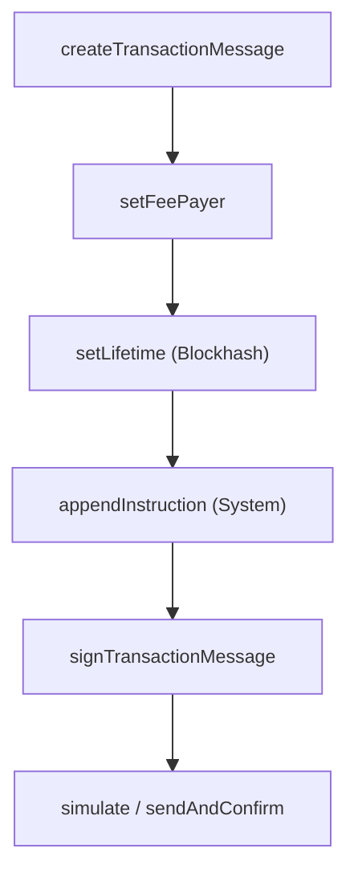

# 💻 Sesión 6: Solana Kit en TypeScript (RPC, `pipe` y Transacciones)

Basado en la sesión 6 del **Rust Bootcamp (Dev3pack x Solana)** (por Fabián).  
🎥 Video original: [Session 6 - Solana Kit en TypeScript](https://www.youtube.com/watch?v=cXijCUOqnII)  
Transcripción completa guardada en: [`../transcripciones/transcripcion_rust_session_6.txt`](../transcripciones/transcripcion_rust_session_6.txt)

---

## 📌 1. On-Ramps, Off-Ramps y RWAs (Contexto Fiat) `[0:05:20]`

* Para conectar dinero fiat (ej. ARS, MXN, USD) con cripto se usan proveedores **On-Ramp / Off-Ramp** con validación **KYC** y alianzas bancarias.
* Caso mencionado: **Etherfuse** (conversión de MXN vía Banco de México a USDC/USDT y tokenización de bonos gubernamentales como **RWAs** — *Real World Assets*).

---

## ⚡ 2. ¿Por qué Solana Kit en lugar de `@solana/web3.js` legado? `[0:13:37]`

**Solana Kit** es el SDK oficial moderno en TypeScript de Solana. Frente a versiones anteriores ofrece:
1. **Tree-shakable:** Empaqueta solo lo que importás, reduciendo drásticamente el tamaño del bundle en frontend.
2. **Funcional e inmutable:** Trabaja con funciones puras y datos inmutables en lugar de clases gigantes.
3. **Type-Safe:** Detecta errores de llaves, tipos y cuentas en tiempo de compilación.
4. **Clientes generados por IDL:** Paquetes dedicados como `@solana-program/system`, Token o Compute Budget.

---

## 🌐 3. Comunicación con la Red: HTTP RPC y WebSockets `[0:21:00]` `[0:25:59]`

* **`createSolanaRpc` (HTTP):** Consultas (`getLatestBlockhash`, `getBalance`), simulación y envío (`sendTransaction`).
* **`createSolanaRpcSubscriptions` (WebSockets):** Escucha en tiempo real hasta confirmar que la transacción alcanzó el estado `confirmed`.
* *Tip de seguridad:* Guardar la URL de tu RPC privado en `.env` y usar `BigInt` (`10000000n` lamports = `0.01 SOL`) para montos exactos.

---

## 🔁 4. Patrón `pipe`: Construcción, Firma y Envío `[0:53:20]` `[1:05:30]`

En Solana Kit, las transacciones se ensamblan paso a paso de forma declarativa usando el patrón **`pipe`**:

1. **Crear mensaje vacío** y definir el **`feePayer`** (el pagador de la comisión; permite implementar flujos *gasless* pagados por el backend `[0:40:32]`).
2. **Fijar *lifetime*** usando `blockhash` y `lastValidBlockHeight` recientes.
3. **Agregar instrucciones** (ej. transferencia con `@solana-program/system`).
4. **Firmar** con el `KeyPairSigner` (cargado en pruebas desde `~/.config/solana/id.json` con `fs`, nunca en producción) y obtener la firma.

---

## 🚀 5. Simulación, Confirmación y Manejo de Errores `[1:05:30]` `[1:16:43]`

* **Simulación (`base64`) y *Preflight*:** Permiten detectar errores antes de gastar comisión (ej. código `0x1` del System Program = lamports insuficientes).
* **Envío y confirmación:** `sendAndConfirmTransaction` combina RPC HTTP + WebSocket esperando `commitment: 'confirmed'`.
* **En la demo en Devnet `[1:12:59]`:** Se ejecutó la transferencia exitosamente consumiendo **150 *compute units*** e inspeccionando los logs de invocación al `System Program` (`1111...1111`) en el explorador.
