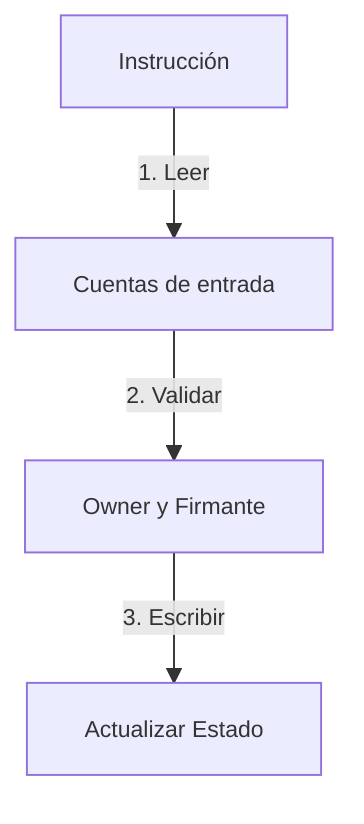

# ⚓ Sesión 7: Introducción a Anchor, Testing y Despliegue en Devnet

Basado en la sesión 7 del **Rust Bootcamp (Dev3pack x Solana)** (por Santiago).  
🎥 Video original: [Session 7 - Anchor en Solana](https://www.youtube.com/watch?v=Ea57RxASgJA)  
Transcripción completa guardada en: [`../transcripciones/transcripcion_rust_session_7.txt`](../transcripciones/transcripcion_rust_session_7.txt)

---

## 📌 1. ¿Qué es Anchor y por qué usarlo? `[0:08:28]`

**Anchor** es el framework estándar para construir programas en Solana. Frente a programar en Rust nativo puro, resuelve los principales dolores de cabeza:
* **Reduce el *boilerplate*:** Evita escribir serialización/deserialización manual de bytes en cada cuenta.
* **Seguridad automática:** Valida automáticamente quién es el *owner* de cada cuenta y si las firmas requeridas están presentes.
* **Interfaces tipadas (IDL):** Genera un archivo JSON para que el cliente y los tests en TypeScript interactúen con autocompletado y tipos seguros.
* **Mejor manejo de errores:** Permite definir errores de negocio personalizados y legibles.

---

## 🧠 2. Modelo de Datos: Programa vs. Cuenta `[0:10:41]`

En Solana, la lógica y los datos están estrictamente separados:
* **Programa (*Stateless*):** Contiene únicamente las instrucciones ejecutables (`initialize`, `increment`, etc.). No guarda variables internas.
* **Cuentas (*Stateful*):** Almacenan el estado *on-chain* (balances, datos del usuario, configuraciones).

---

## 🏗️ 3. Estructura de un Proyecto Anchor (`counter`) `[0:14:10]` `[0:19:45]`

Al crear el proyecto con `anchor init counter`, se recomienda una arquitectura modular dentro de `programs/counter/`:

* **`lib.rs`:** Declara el `Program ID` (`declare_id!`) y el módulo `#[program]` con los *handlers* públicos.
* **`state/`:** Define las estructuras de datos almacenadas en cuentas (ej. `Counter` con `authority: Pubkey` y `count: u64`). Al inicializar una cuenta, se calcula su tamaño en bytes + **8 bytes del discriminador** de Anchor.
* **`instructions/`:** Separa cada instrucción (`initialize`, `increment`) con su `struct` de cuentas (`#[derive(Accounts)]`) y su función `handle_*`.
* **`constants.rs`:** Seeds (`Counter Seed`) y límites (`Max Count`).
* **`errors.rs`:** Errores personalizados (ej. `CountOverflow`) para evitar errores genéricos de Rust.
* **`Anchor.toml`:** Configuración del `Program ID`, `provider` (cluster y wallet) y scripts.

---

## 🛠️ 4. Comandos Esenciales del Flujo de Trabajo `[0:33:13]` `[0:38:27]`

1. **Verificar versión del CLI:** `anchor --version` (ej. `1.1.2`).
2. **Inicializar proyecto:** `anchor init counter`.
3. **Sincronizar llaves:** `anchor keys sync` (asegura que el ID en el código coincida con `Anchor.toml`).
4. **Compilar:** `anchor build`.
5. **Ejecutar tests locales:** `anchor test`.
6. **Configurar Devnet y fondear wallet:** Si `solana airdrop` falla por congestión, solicitar SOL desde el *faucet* web oficial (`faucet.solana.com`).

---

## 🧪 5. Patrones de Testing, Seguridad y Despliegue `[0:41:27]` `[0:49:39]`

### Patrones de Testing Avanzados en Solana
* **Inyección directa de estado (*Mockeo*):** Escribir bytes directamente en cuentas de prueba sin pasar por transacciones previas.
* **Manipulación del reloj:** Simular el paso del tiempo para probar bloqueos temporales u oráculos.
* **Pruebas de cuentas maliciosas:** Verificar que la instrucción falle si:
  * Se pasa una cuenta con un *owner* falso.
  * Se intenta usar una cuenta derivada de otro usuario.
  * Falta la firma de la cuenta administrativa (`authority`).
  * Se intenta reutilizar una cuenta cerrada dentro de la misma transacción.

### Regla de Oro en Instrucciones `[0:53:19]`
Ejecutar siempre en este orden estricto: **Leer $\rightarrow$ Validar (`owner`, `signer`, dirección esperada) $\rightarrow$ Escribir**.
Finalmente, tras desplegar en `devnet`, se pueden monitorear los logs del programa en tiempo real y ejecutar scripts de prueba (`initialize` + llamadas a `increment`).
