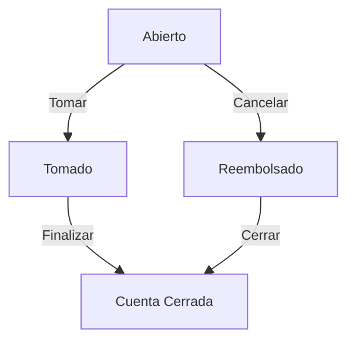

# 🛡️ Sesión 8: Despliegue Local, Máquinas de Estado y Seguridad

Basado en la sesión 8 del **Rust Bootcamp (Dev3pack x Solana)**.  
🎥 Video original: [Session 8 - Despliegue y Seguridad en Solana](https://www.youtube.com/watch?v=ZWlm8H3htKc)  
Transcripción completa guardada en: [`../transcripciones/transcripcion_rust_session_8.txt`](../transcripciones/transcripcion_rust_session_8.txt)

---

## 📌 1. Ciclo General: Construir, Desplegar y Proteger `[0:07:54]`

El flujo recomendado para llevar un programa a producción sigue tres entornos progresivos:
1. **Validador Local (`solana-test-validator`):** Se ejecuta en una terminal separada como servidor continuo para iterar rápido sin depender de internet ni faucets.
2. **Devnet:** Red de pruebas pública para validar integraciones reales con wallets y frontends.
3. **Mainnet:** Entorno productivo con fondos reales (definir de antemano si el programa será actualizable o inmutable).

---

## 🖥️ 2. Depuración en Entorno Local y Devnet `[0:09:26]` `[0:27:30]`

Durante las pruebas en vivo en el proyecto `counter`, se resolvieron dos problemas habituales en el día a día con Solana:
* **Validador ocupado o no iniciado:** Levantar el validador local en una terminal dedicada y ejecutar `anchor deploy` / tests en otra terminal aparte.
* **Conflictos de dependencias en Cargo/Solana CLI:** Al actualizar versiones del CLI, remover artefactos o paquetes incompatibles y actualizar dependencias con `cargo` antes de volver a compilar y desplegar.

---

## ⚙️ 3. Diseño con Máquinas de Estados Finitos `[0:18:48]`

Antes de escribir código en Rust, el instructor recomienda **diagramar el programa como una Máquina de Estados Finitos** en 3 pasos:

1. **Nombrar todos los estados posibles:** Por ejemplo, en un flujo de ofertas: *Abierto*, *Tomado*, *Cancelado* / *Cerrado*.
2. **Definir un *handler* por cada transición:** Cada instrucción del contrato representa una transición válida (ej. `handle_increment`, `tomar_oferta`, `cancelar`).
3. **Cerrar siempre los estados finales:** Ninguna cuenta debe quedar "colgada" sin posibilidad de cerrarse y devolver su renta.

---

## 🔢 4. Aritmética Segura y Manejo de Dinero `[0:21:07]`

* **Prohibido usar flotantes (`f64` / `f32`) para montos:** Los decimales en punto flotante introducen errores de redondeo inaceptables en finanzas.
* **Escalar a enteros:** Todo monto se representa como entero sin signo (`u64` en *lamports* o unidades base del token).
* **Prevenir desbordamientos (*Overflow*):** Usar aritmética verificada (`checked_add`, `checked_mul`) y promover multiplicaciones intermedias a **`u128`** antes de dividir, evitando errores silenciosos de truncamiento.

---

## ✅ 5. Checklist de Seguridad Antes de Desplegar `[0:23:15]`

1. **Verificación de Autoridad (`Signer`):** Comprobar que quien llama la instrucción administrativa realmente firmó la transacción.
2. **Verificación de *Owner*:** Asegurar que la cuenta le pertenece al programa (y no fue inyectada desde otro programa).
3. **Integridad del Estado:** Validar precondiciones estrictas para evitar ataques de doble ejecución (ej. tomar dos veces la misma oferta).
4. **Cierre de cuentas y Renta:** Cerrar las cuentas que terminaron su ciclo de vida para recuperar el SOL de renta y no dejar saldo varado.
5. **¿Guardar fechas en cuentas? `[0:26:01]`:** No suele ser necesario porque cada transacción ya registra su *timestamp* en el ledger, salvo casos concretos donde necesites consultar la última modificación *on-chain* de forma eficiente.
