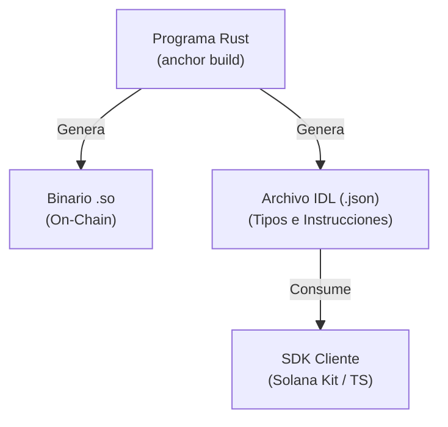

# 🚀 Sesión 9: Deploy (Playground y CLI), RPCs, IDL y Upgrades

Basado en la sesión 9 del **Rust Bootcamp (Dev3pack x Solana)**.  
🎥 Video original: [Session 9 - Full Stack on Solana (Deploy e IDL)](https://www.youtube.com/watch?v=DTPszga9W9Y)  
Transcripción completa guardada en: [`../transcripciones/transcripcion_rust_session_9.txt`](../transcripciones/transcripcion_rust_session_9.txt)

---

## 📌 1. ¿Qué significa hacer Deploy en Solana? `[0:04:22]`

A diferencia del *unit testing* local, hacer **deploy** consiste en compilar tu programa Rust a un binario ejecutable **`.so`** y subirlo a una red real (nodo local, `Devnet` o `Mainnet`).  
Al desplegar, intervienen 3 elementos clave:
* **`Program ID`:** La dirección única del contrato (`declare_id!`).
* **`Program Account` y `Program Data Account`:** Las cuentas donde vive el código ejecutable `.so` (marcadas como `executable`).
* **`Program Authority` (o *Upgrade Authority*):** La wallet con permisos para actualizar o cerrar el programa.

---

## 🌐 2. Método 1: Solana Playground (`beta.solpg.io`) `[0:08:26]`

Ideal para prototipar y desplegar rápido sin peleas de entorno local:
* Incluye plantillas de **Anchor**, **Seahorse** (Python), **Metaplex** (NFTs) y **Solana Cookbook**.
* Permite compilar remotamente en el navegador (**Build**) generando el archivo `.so`.
* Se puede importar tu *keypair* local (`.config/solana/id.json`), pedir SOL de prueba (ej. 2 veces `0.5` SOL para cubrir ~`1.06` SOL de renta del deploy) y desplegar directo a `Devnet`.

---

## 💻 3. Método 2: Solana CLI y RPCs (Públicos vs. Privados) `[0:22:18]`

Comandos básicos de configuración e inspección por terminal:
* Ver configuración actual: `solana config get`
* Cambiar a Devnet: `solana config set --url devnet`
* Solicitar fondos de prueba: `solana airdrop 2`

### RPCs Públicos vs. Privados `[0:24:41]`
* El RPC público por defecto (`api.devnet.solana.com` / `api.mainnet-beta.solana.com`) tiene límites estrictos (*rate limit*) y se satura fácilmente durante eventos o hackathones.
* Para aplicaciones reales o deploys sin trabas conviene usar **RPCs privados** (como **QuickNode**, Helius, etc.).

---

## 🔍 4. Verificación en Solscan y Costos de Renta `[0:31:00]` `[0:38:00]`

* **Solscan (en modo Devnet):** Pegando el `Program ID`, podés verificar que la cuenta sea `executable`, revisar su `Upgrade Authority`, la transacción de despliegue y el metadato `security.txt` (contacto de seguridad).
* **Tamaño y costo del binario `.so`:** Al ejecutar `anchor build`, el binario compilado se guarda en `target/deploy/*.so`. Su tamaño en bytes determina el SOL mínimo necesario para cubrir la exención de renta (*rent-exempt* — ej. `123,656` bytes $\approx$ `0.6288` SOL).

---

## 🔌 5. Integración Full Stack: SDKs e IDL de Anchor `[0:33:27]` `[0:36:21]`

* **IDL (*Interface Description Language*):** Archivo JSON generado por Anchor que describe todas las instrucciones, cuentas y tipos (ej. `u32`, `u64`). Es el equivalente a OpenAPI/Swagger para tu frontend.
* **SDKs disponibles:** TypeScript/JavaScript (**Solana Kit** / `@solana/web3.js`), Go (**Anchor-Go**), Python y Java. Permiten además **composabilidad** entre protocolos (un programa llamando a otro vía CPI).

---

## 🔄 6. Gestión y Actualización (*Upgrades*) de Programas `[0:45:56]`

* Inspeccionar un programa desplegado: `solana program show <PROGRAM_ID>` (muestra `owner`, `authority`, balance, tamaño en bytes y último *slot* desplegado).
* **Cómo funciona el *upgrade*:** La `Program Authority` puede subir un nuevo `.so` sobre el **mismo `Program ID`** (si el binario creció en bytes, primero se extiende el espacio de la cuenta).
* **Inmutabilidad por confianza:** A diferencia de Ethereum (donde se despliega un contrato nuevo), en Solana se puede actualizar *in-place*; por eso, muchos protocolos DeFi maduros **renuncian a la autoridad** (*set-authority --final*) para garantizar a los usuarios que el código jamás cambiará.
