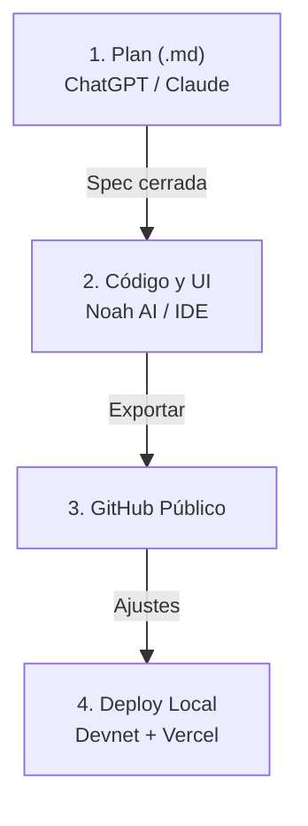

# 🤖 Vibecoding en Solana: De Idea a DApp en Devnet con IA

Basado en la sesión 11 del **Rust Bootcamp (Dev3pack)**: **Vibecode your first app on Solana** (por Santiago y Solène).  
🎥 Video original: [Vibecode your first app on Solana](https://www.youtube.com/watch?v=cMhjoZOhM0Q)  
Transcripción completa en inglés guardada en: [`../transcripciones/transcripcion_rust_session_11.txt`](../transcripciones/transcripcion_rust_session_11.txt)

---

## 🚨 1. Dato Crítico Confirmado para Calificar `[1:27:06]`

Al cierre de la sesión, Solène confirmó un requisito fundamental del hackathon:
> **"Toda entrega debe integrar un *Solana Program* (programa on-chain) para calificar."**

Podés programar el contrato en Rust/Anchor por tu cuenta, con tu agente de IA local (con contexto/MCPs de Solana), o generarlo dentro de **Noah AI** y conectarlo al frontend usando su **`Program ID`** e **`IDL`**.

---

## 🧠 2. De "Vibecoding" a *AI Engineering* `[0:09:46]`

Santiago explicó que el cuello de botella hoy ya no es escribir código línea por línea, sino **diseñar bien el producto**. Para no generar código basura (*AI slop*), propone trabajar con ingeniería asistida por IA:

* **Regla 50 / 50:** Dedicar **50% del tiempo a planificar** y **50% a ejecutar**.
* **Usa un "Segundo Cerebro" (`.md`):** Documentar la especificación, el modelo de datos, los supuestos y las decisiones en un archivo Markdown antes de pedirle código al agente.
* **Resuelve todo en los primeros 2-3 prompts:** Si empezás sin un plan claro, el agente pierde contexto y terminás rehaciendo todo.
* **Prompts en inglés:** Consumen menos tokens y dan respuestas más precisas en la mayoría de LLMs.
* **Velocidad sobre sobre-ingeniería:** Para un hackathon no montes infraestructura compleja de AWS; usá herramientas rápidas como **Supabase**, **Vercel** o **Netlify**.

---

## 🏗️ 3. Flujo de Trabajo: El Arquitecto y el Constructor `[0:19:56]`

La estrategia recomendada en la charla consiste en **separar la herramienta que piensa de la que ejecuta**:

1. **El Arquitecto (ChatGPT / Claude / Agente local):**  
   Definís audiencia (ej. UX sin jerga cripto para usuarios no nativos, montos en USD, onboarding simple), reglas de negocio, estados de UI, modelo de datos y contrato de API en un archivo `.md`.
2. **El Constructor (Noah AI o tu agente ejecutor):**  
   Pegás la especificación cerrada para construir la app y ahorrar tokens/créditos.

---

## 🛠️ 4. ¿Qué ofrece Noah AI para Solana? `[0:25:26]`

**Noah AI** funciona como una plataforma tipo *"Lovable enfocada en Solana"* que integra varias piezas en un solo lugar:

* **Modos de creación:** *Full Stack DApp*, *Solana Program* (contratos), *Mobile*, *Games* y documentos.
* **Conectores integrados:**
  * **Supabase:** Para base de datos PostgreSQL, usuarios, secretos y *Edge Functions* en un par de clics.
  * **GitHub:** Exporta el código generado a un repositorio propio para no quedar atado a la plataforma.
  * **Vercel / Netlify:** Despliegue directo de la web.
  * **Solana Program & Faucet:** Panel para generar el programa, obtener su `IDL` y *keypair*, pedir SOL en Devnet y desplegar el contrato obteniendo el `Program ID`.
  * **Visual Edit & Design System:** Permite seleccionar elementos de la UI (como un footer) para pedir cambios puntuales y definir paletas/temas propios para evitar el "estilo genérico de IA".

### ⚠️ Cuidados importantes con Noah AI
* **Consumo rápido de tokens:** Es costoso en créditos (especialmente al generar programas on-chain). Usalo solo para ejecutar, no para hacer *brainstorming*.
* **Respaldo en GitHub:** Si te quedás sin créditos, exportá el proyecto a GitHub, clonalo en tu máquina y seguí desarrollándolo con **Claude Code, Codex o tu agente local** conectado a MCPs/documentación de Solana.
* **Keypairs de programas:** Si descargás el *keypair* administrador del programa para desplegarlo localmente, protegelo siempre y no lo subas público al repo.
