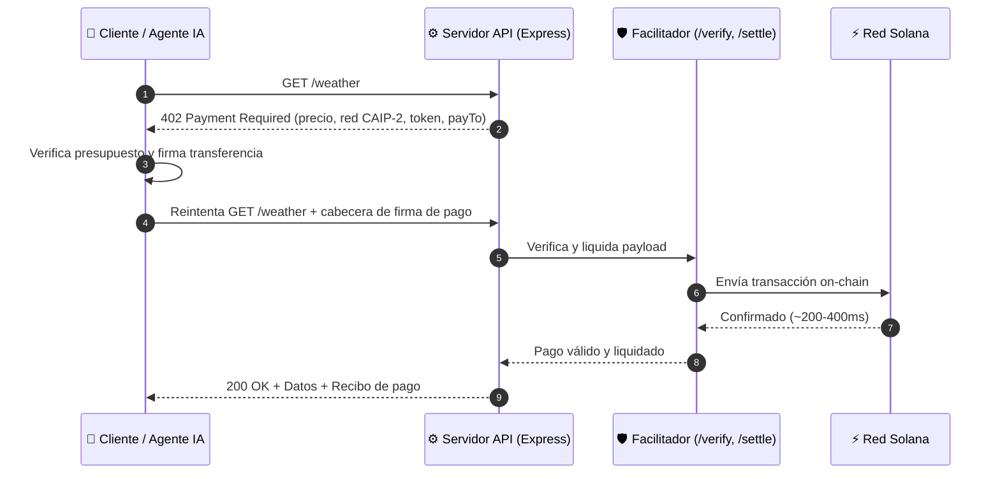

# ⚡ Micropagos en Solana con el Protocolo x402

Basado en la sesión 12 del **Rust Bootcamp (Dev3pack)**: **Enable micro-payments with x402 on Solana** (por Fabián).  
🎥 Video original: [Enable micro-payments with x402 on Solana](https://www.youtube.com/watch?v=BoqpFVoYWQg)  
Transcripción completa en inglés guardada en: [`../transcripciones/transcripcion_rust_session_12.txt`](../transcripciones/transcripcion_rust_session_12.txt)

---

## 📌 1. El Problema: La Web Nunca Tuvo Pagos Nativos `[0:06:40]`

Desde los años 90, el protocolo HTTP reservó el código de estado **`402 Payment Required`**, pero quedó sin uso durante décadas. Por eso, en la Web 2.0 tuvimos que "pegarle" sistemas de pago encima con mucha fricción:
1. **Cuentas y registros:** Email, contraseña y un humano completando formularios de onboarding.
2. **API Keys y planes:** Suscripciones mensuales, facturación previa y límites rígidos.
3. **Comisiones de tarjetas:** Hacen imposible cobrar micropagos (ej. \$0.001 por llamada a una API), porque la comisión bancaria se come todo el pago.

En resumen: **la web se diseñó para humanos frente a un navegador, no para software ni Agentes de IA actuando por su cuenta.**

---

## 🌐 2. ¿Qué es x402? `[0:09:31]`

**x402** es un protocolo abierto (iniciado por Coinbase en 2025 y mantenido bajo la **x402 Foundation / Linux Foundation**) que convierte el código HTTP **`402 Payment Required`** en un paso real de pago nativo en la web.

* **Es HTTP puro:** Cualquier API o página web puede pedir un pago antes de devolver una respuesta, sin cuentas, sin API keys ni checkouts.
* **Nativo en Stablecoins y agnóstico a la cadena:** Permite pagar en USDC u otros tokens.
* **¿Por qué Solana es ideal para x402?**
  * **Finalidad ultrarrápida** (~200-400 ms), clave para no frenar una petición HTTP/API.
  * **Comisiones mínimas** que hacen rentables los micropagos de fracciones de centavo.
  * Soporte para cualquier **token SPL o Token-2022**.

---

## 🔄 3. Arquitectura: Roles y Flujo en 5 Pasos `[0:10:51]`

### Los 3 Roles (*Trust-Minimizing*)
1. **Client (Comprador):** App, script o Agente de IA con una wallet que lee el precio, verifica sus límites de presupuesto (*guardrails*) y firma el pago.
2. **Server (Vendedor / API):** Tu backend (ej. Node.js + Express) con un middleware que define el precio por ruta y responde `402` hasta recibir un pago válido.
3. **Facilitator (Facilitador):** Servicio auxiliar recomendado que expone `/verify`, `/settle` y `/supported`. Permite que tu servidor **no tenga que conectarse directamente a nodos RPC** para validar y liquidar la transacción en Solana.

*(Ni el servidor ni el facilitador pueden mover fondos sin la firma criptográfica del cliente).*

### Flujo de una Petición HTTP con x402

---

## 🛠️ 4. Implementación Técnica en Solana (TypeScript) `[0:20:57]`

En los paquetes del ecosistema (`@x402/core`, `@x402/express`, `@x402/svm`, `@x402/fetch`):

### Campos clave de configuración en Solana:
* **`network`:** Identificador estándar **CAIP-2** (ej. Solana Devnet vs Mainnet).
* **`asset`:** Dirección *mint* del token SPL o Token-2022 (ej. USDC).
* **`payTo`:** Dirección pública de la wallet receptora en Solana (SVM address).
* **`amount`:** En **unidades base del token** (ej. USDC tiene 6 decimales $\rightarrow$ 0.001 USDC = `1000`).
* **`scheme`:**
  * `exact`: Precio fijo por llamada.
  * `upTo`: Pago basado en uso hasta un máximo autorizado por el cliente.

### Automatización en el Cliente
Usando `wrapFetchWithPayment` (de `@x402/fetch`) junto con límites de gasto (*spend controls*), el cliente **gestiona automáticamente el ciclo `402` $\rightarrow$ firmar $\rightarrow$ reintentar**, recibiendo directamente el `200 OK` con la respuesta.

---

## 🤖 5. Casos de Uso para el Hackathon (IA + Micro-pagos) `[0:41:28]`

Fabián destacó que **los rieles ya están listos, pero aún faltan aplicaciones realmente útiles construidas encima**. Ideas concretas mencionadas:

1. **Agentes con `pay.sh` y MCPs de pago (*Paid MCP Tools*):**  
   * Con herramientas como **`pay.sh`** (de Solana AI), agentes como Claude o ChatGPT pueden descubrir endpoints x402 y pagar llamadas a APIs en tiempo real (con autorización biométrica o automática dentro de un presupuesto).
   * Podés crear **servidores MCP pagos** que cobren micropagos por consultar datos especializados, búsquedas o inferencia de modelos.
2. **APIs *Pay-per-Request* (Sin API Keys):**  
   Monetizar cualquier endpoint de datos, clima, finanzas o IA cobrando centavos por petición sin obligar al usuario a registrarse ni pagar suscripciones mensuales.
3. **Agentes Auto-financiados (*Self-funding agents*):**  
   Un agente que cobra en USDC por realizar una tarea y usa esas ganancias en tiempo real para pagar las APIs que necesita para su siguiente llamada.
4. **Contenido y Recursos Micro-tarifados:**  
   Pago por artículo, imagen generada, dataset, lecturas de sensores DePIN, minutos de GPU, llamadas RPC por uso o sesiones de juego.

---

## 🔗 Recursos Mencionados
* Documentación oficial: [`x402.org`](https://x402.org) / `docs.x402.org`
* Faucet de pruebas Solana Devnet: [`faucet.solana.com`](https://faucet.solana.com) (máximo 2 solicitudes cada 8 horas).
* Infraestructura Solana AI: `solana.ai` / `pay.sh`
